# Лабораторная работа 4

## Задание A

Результат работы:
1. Выполняется кодировка по умолчанию UTF-8, другую передают параметром encoding, например cp1251.
2. Ошибки FileNotFoundError и UnicodeDecodeError не перехватываются.
3. Файл читается целиком. В реальных задачах большие файлы стоит читать построчно.
4. Описание краевых случаев (пустой файл, пустой rows, только заголовок).

Ручной мини-тест `io_txt_csv.py` для README:
Запуск из корня репозитория:
```
python3 -m src.lab04.test_A
```
```python 
from src.io_txt_csv import read_text, write_csv
txt = read_text("data/input.txt")  # должен вернуть строку
write_csv([("word","count"),("test",3)], "data/check.csv")  # создаст CSV
```
Скрипт читает `data/lab04/input.txt` и создаёт `data/lab04/check.csv`.

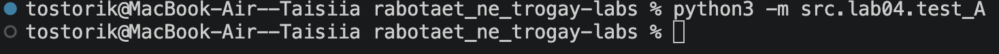
Рис.1 Запуск мини-теста

### Задание A: крайние случаи

**1. Пустой входной файл -> возвращается пустая строка**
```
python3 -c "from src.lab04.io_txt_csv import read_text; print(repr(read_text('data/lab04/empty.txt')))"
```
Ожидаемый результат: `''`
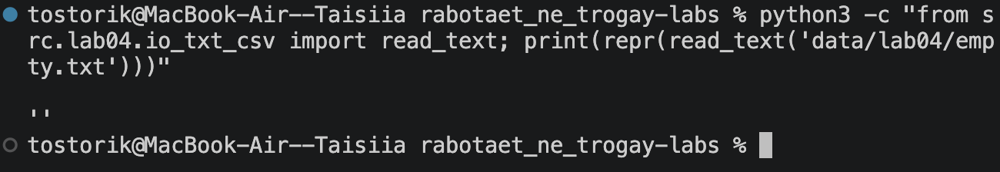
Рис. 2 read_text для пустого файла возвращает пустую строку

**2. `write_csv` с пустым `rows` и `header=None` → пустой файл**
```
python3 -c "from src.lab04.io_txt_csv import write_csv; write_csv([], 'data/lab04/empty.csv')"
ls -l data/lab04/empty.csv
```
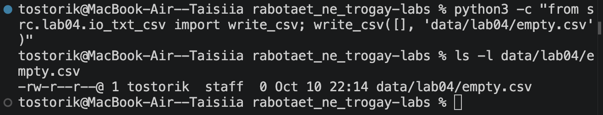
Рис.3 Пустой rows без заголовка: файл создан, размер 0 байт

**3. `write_csv` с пустым `rows` и `header=("a","b")` → только заголовок**
```
python3 -c "from src.lab04.io_txt_csv import write_csv; write_csv([], 'data/lab04/header_only.csv', header=('a','b'))"
cat data/lab04/header_only.csv
```
Ожидаемый результат: `a,b`
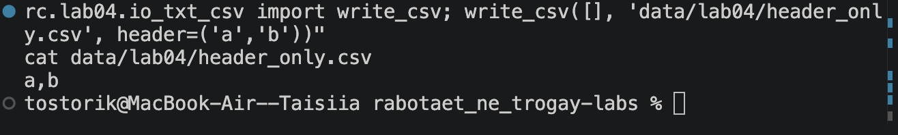
Рис.4 Пустой rows с заголовком: в файле только строка a,b

**4. Строки разной длины → `ValueError`**
```
python3 -c "from src.lab04.io_txt_csv import write_csv; write_csv([(1,2),(3,)], 'data/lab04/bad.csv')"
```
Ожидаемый результат: ошибка `ValueError: Все строки (и заголовок) должны быть одинаковой длины`.
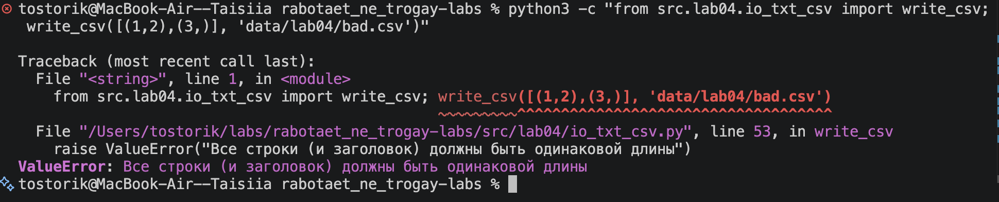
Рис.5 Строки разной длины вызывают ValueError

**5. Очень большой файл**

Файл читается целиком, это допустимо по ТЗ. В реальных задачах большие файлы
стоит читать построчно, чтобы не загружать весь файл в память.

## Задание B

Скрипт читает текстовый файл, нормализует и токенизирует текст функциями из ЛР3
(`normalize`, `tokenize` из `src/lib/text.py`), считает частоты слов, сохраняет
отчёт в CSV и печатает краткое резюме в консоль.

### Запуск
Все команды выполняются из корня репозитория.
```
python3 src/lab04/text_report.py
python3 src/lab04/text_report.py --in data/lab04/input.txt --out data/lab04/report.csv
python3 src/lab04/text_report.py --in data/lab04/input.txt --encoding cp1251
```

### Параметры командной строки

| Параметр     | По умолчанию            | Описание                          |
|--------------|-------------------------|-----------------------------------|
| `--in`       | `data/lab04/input.txt`  | входной текстовый файл            |
| `--out`      | `data/lab04/report.csv` | выходной CSV                      |
| `--encoding` | `utf-8`                 | кодировка входного файла          |

### Формат отчёта

`report.csv` содержит столбцы `word,count`. Строки отсортированы по убыванию
`count`, а при равенстве по слову в алфавитном порядке. В консоль выводятся
общее количество слов, количество уникальных слов и топ-5 (сортировка та же,
что в `top_n` из ЛР3).

### Поведение в краевых случаях

- **Файл не найден:** скрипт печатает сообщение `Ошибка: файл не найден: <путь>`
  и завершается через `sys.exit(1)`.
- **Пустой вход:** в `report.csv` записывается только заголовок `word,count`.
- **Нестандартная кодировка:** кодировка передаётся параметром `--encoding`,
  например `--encoding cp1251`. Если файл в cp1251 прочитать как utf-8,
  Python выдаст `UnicodeDecodeError`.

### Тест-кейсы

#### A. Один файл (база)

Вход `data/lab04/input.txt`: `Привет, мир! Привет!!!`

```
python3 src/lab04/text_report.py
cat data/lab04/report.csv
```

Консоль:

```
Всего слов: 3
Уникальных слов: 2
Топ-5:
привет:2
мир:1
```

`report.csv`:

```
word,count
привет,2
мир,1
```
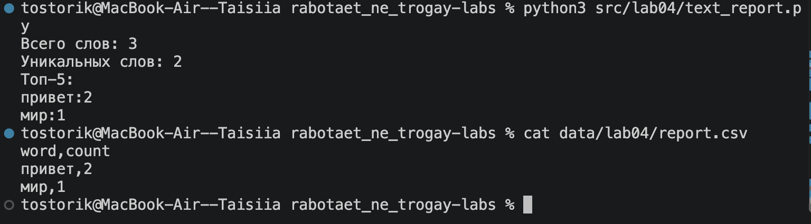
Рис. 6. Тест-кейс A: запуск базовой версии


#### B. Пустой файл

Вход: пустой `data/lab04/empty.txt`.

```
python3 src/lab04/text_report.py --in data/lab04/empty.txt --out data/lab04/report_empty.csv
cat data/lab04/report_empty.csv
```

Результат: в консоли `Всего слов: 0`, `Уникальных слов: 0`, пустой топ-5. В CSV только заголовок `word,count`.

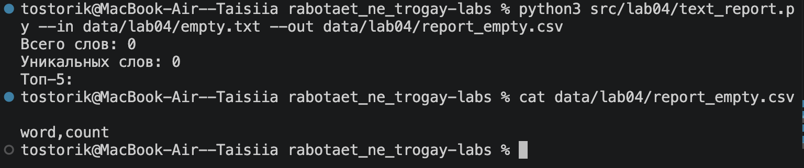
Рис. 7. Тест-кейс B: пустой файл, в отчёте только заголовок


#### C. Кодировка cp1251

Вход: `data/lab04/input_cp1251.txt` с текстом `Привет` в кодировке cp1251.

```
python3 src/lab04/text_report.py --in data/lab04/input_cp1251.txt --encoding cp1251 --out data/lab04/report_cp1251.csv
cat data/lab04/report_cp1251.csv
```

Результат: в CSV `привет,1`.

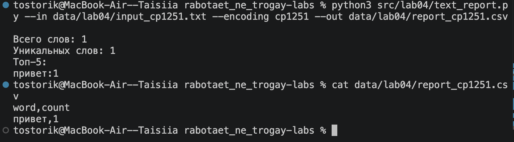
Рис. 8. Тест-кейс C: чтение файла в cp1251 с параметром --encoding

Тот же файл без `--encoding cp1251` вызывает `UnicodeDecodeError`:
```python
python3 src/lab04/text_report.py --in data/lab04/input_cp1251.txt --out data/lab04/report_cp1251.csv
```

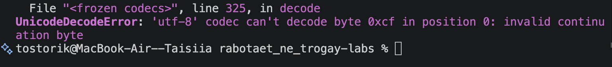
Рис. 9. Без указания кодировки файл cp1251 не читается как utf-8

### Несколько файлов и таблица

```
python3 src/lab04/text_report.py --in data/lab04/a.txt data/lab04/b.txt --per-file data/lab04/report_per_file.csv --total data/lab04/report_total.csv --table
cat data/lab04/report_per_file.csv
cat data/lab04/report_total.csv
```

`report_per_file.csv` (`file,word,count`) содержит частоты по каждому файлу, `report_total.csv` (`word,count`) сводку по всем файлам. Флаг `--table` печатает таблицу в консоль с шириной столбцов по максимуму.

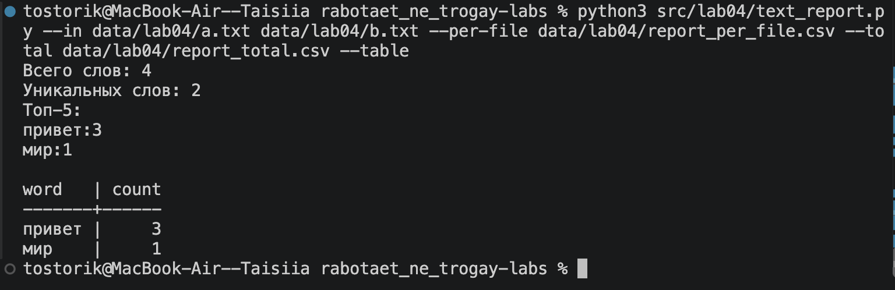
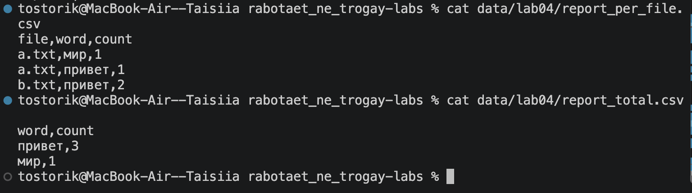
Рис. 10 и 11. Тест D: несколько файлов, отчёты и таблица