# Лабораторная работа 5

**Цель:** разобраться с форматом JSON, сериализацией и десериализацией, научиться конвертировать табличные данные между JSON, CSV и XLSX.
Все команды запускаются **из корня репозитория** (пути в коде относительные).

## Подготовка

Установка единственной внешней зависимости (`openpyxl`, нужна только для XLSX):

```bash
python3 -m pip install -r requirements.txt
```

---

## Задание A — JSON <-> CSV

### Задание

Модуль `src/lab05/json_csv.py` с двумя функциями:

- `json_to_csv(json_path, csv_path)` — JSON (список словарей) -> CSV;
- `csv_to_json(csv_path, json_path)` — CSV -> JSON (список словарей).

**Допущения:**

- JSON -> CSV: порядок колонок — ключи первого объекта, затем новые ключи из остальных объектов в порядке появления; отсутствующие поля и `null` -> пустая строка; вложенные `dict`/`list` записываются как JSON-строка.
- CSV -> JSON: первая строка — обязательный заголовок; все значения сохраняются **строками** (`"age": "22"`); разделитель (`,` `;` табуляция) определяется автоматически.
- Кодировка строго UTF-8, запись JSON через `ensure_ascii=False, indent=2`.

### Запуск

Конвертация JSON->CSV и CSV->JSON:

```bash
python3 -c "from src.lab05.json_csv import json_to_csv, csv_to_json; json_to_csv('data/lab05/samples/people.json', 'data/lab05/out/people_from_json.csv'); csv_to_json('data/lab05/samples/people.csv', 'data/lab05/out/people_from_csv.json')"
```

Просмотр результата JSON->CSV (заголовок и строки):

```bash
cat data/lab05/out/people_from_json.csv
```

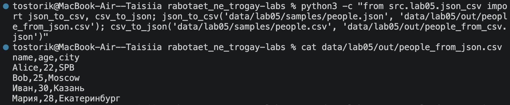
Рис.1 просмотр содержимого файла people_from_json.csv

Просмотр результата CSV->JSON (список объектов):

```bash
cat data/lab05/out/people_from_csv.json
```

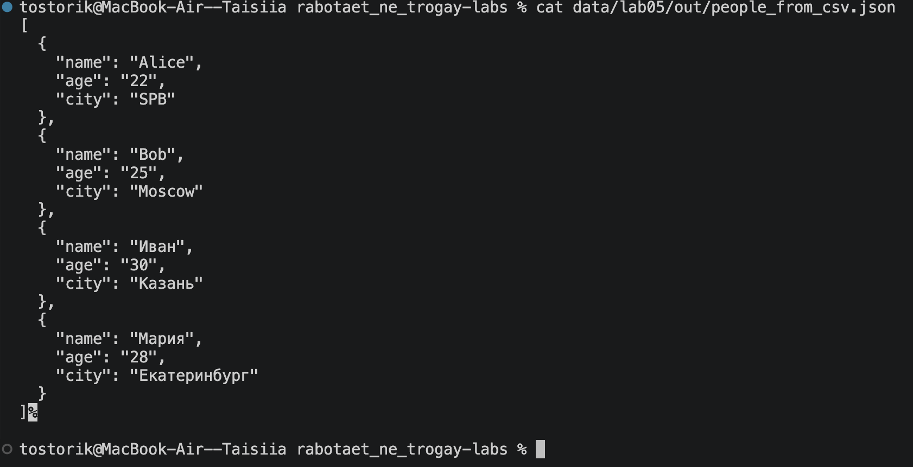
Рис.2 просмотр содержимого файла people_from_csv.json

Проверка количества записей JSON->CSV (исходный JSON и полученный CSV):

```bash
python3 -c "import csv, json; print('Записей в JSON:', len(json.load(open('data/lab05/samples/people.json', encoding='utf-8')))); print('Строк в CSV:', len(list(csv.DictReader(open('data/lab05/out/people_from_json.csv', encoding='utf-8')))))"
```

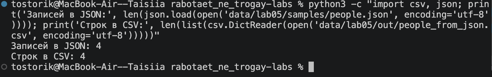
Рис.3 Вывод проверки количества записей

Проверка количества записей CSV->JSON (исходный CSV и полученный JSON):

```bash
python3 -c "import csv, json; print('Строк в CSV:', len(list(csv.DictReader(open('data/lab05/samples/people.csv', encoding='utf-8'))))); print('Объектов в JSON:', len(json.load(open('data/lab05/out/people_from_csv.json', encoding='utf-8'))))"
```

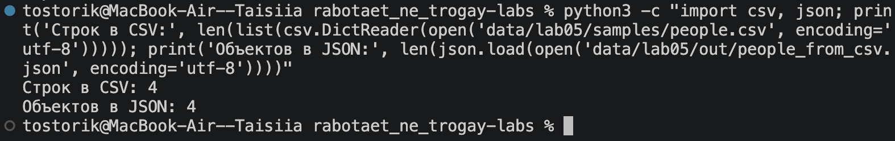
Рис.4 Вывод проверки количества записей

### ДО -> ПОСЛЕ

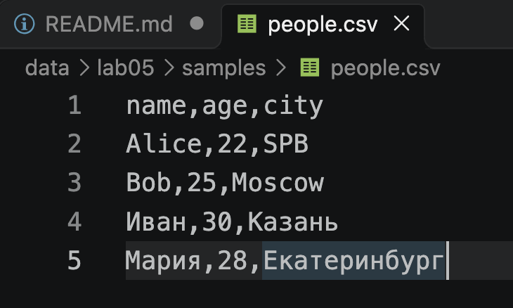  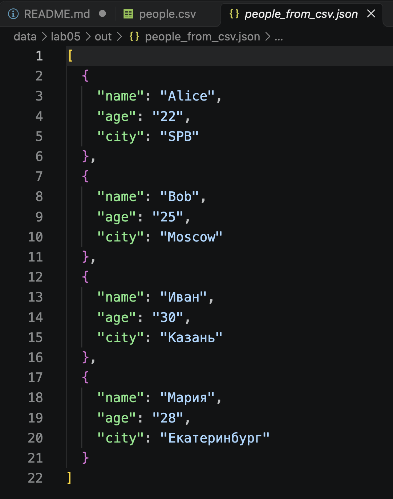
Рис.5 и Рис.6 Результат работы программы по преобразованию файла из CSV в JSON

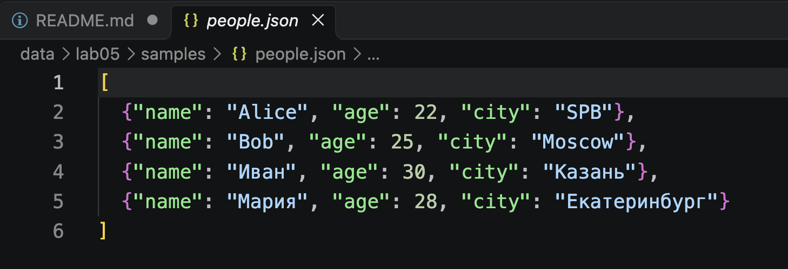 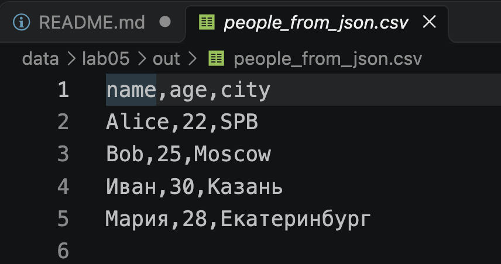
Рис.7 и Рис.8 Результат работы программы по преобразованию файла из JSON в CSV

### Проверка ошибок

Файл не найден (`FileNotFoundError`):

```bash
python3 -c "from src.lab05.json_csv import json_to_csv; json_to_csv('data/lab05/samples/nope.json', 'data/lab05/out/x.csv')"
```

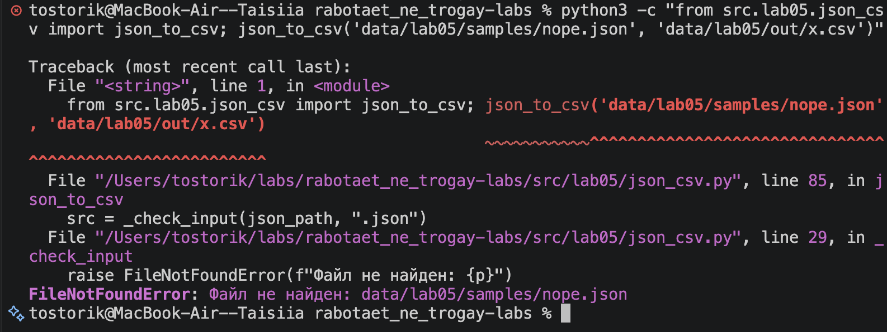
Рис.9 Ошибка: входной JSON-файл не существует

Неверный тип файла (`ValueError`):

```bash
python3 -c "from src.lab05.json_csv import json_to_csv; json_to_csv('data/lab05/samples/people.csv', 'data/lab05/out/x.csv')"
```

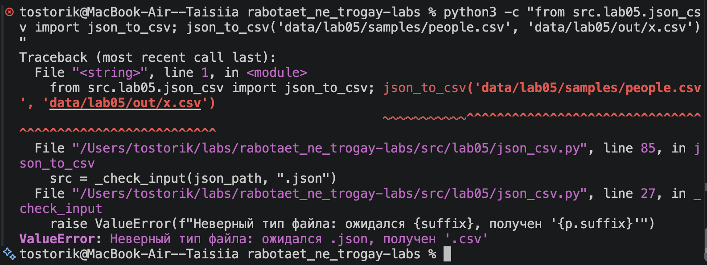
Рис.10 Ошибка: вместо .json передан .csv

Пустой JSON (`ValueError`):

```bash
python3 -c "from src.lab05.json_csv import json_to_csv; json_to_csv('data/lab05/samples/bad/empty.json', 'data/lab05/out/x.csv')"
```

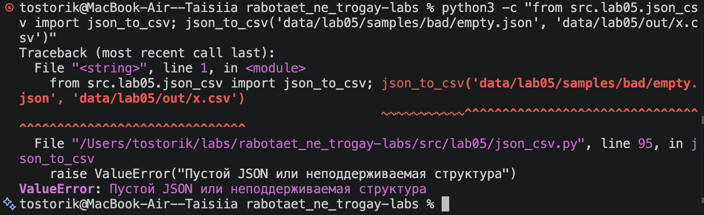
Рис.11 Ошибка: JSON пустой

Список не из словарей (`ValueError`):

```bash
python3 -c "from src.lab05.json_csv import json_to_csv; json_to_csv('data/lab05/samples/bad/not_dicts.json', 'data/lab05/out/x.csv')"
```

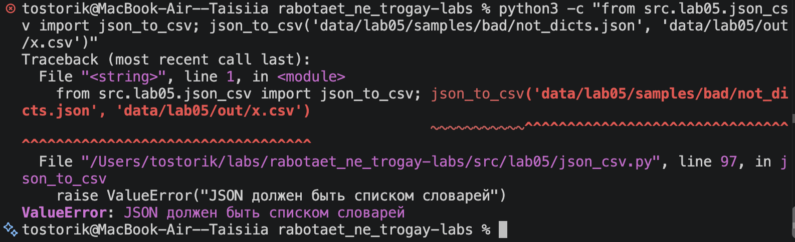
Рис.12 Ошибка: в JSON список чисел, а не словарей

Некорректный JSON (`ValueError`):

```bash
python3 -c "from src.lab05.json_csv import json_to_csv; json_to_csv('data/lab05/samples/bad/broken.json', 'data/lab05/out/x.csv')"
```

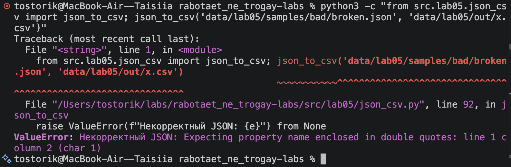
Рис.13 Ошибка: синтаксическая ошибка в JSON

Пустой CSV (`ValueError`):

```bash
python3 -c "from src.lab05.json_csv import csv_to_json; csv_to_json('data/lab05/samples/bad/empty.csv', 'data/lab05/out/x.json')"
```

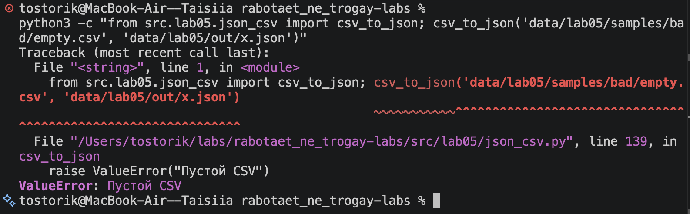
Рис.14 Ошибка: CSV пустой

CSV без данных, только заголовок (`ValueError`):

```bash
python3 -c "from src.lab05.json_csv import csv_to_json; csv_to_json('data/lab05/samples/bad/header_only.csv', 'data/lab05/out/x.json')"
```

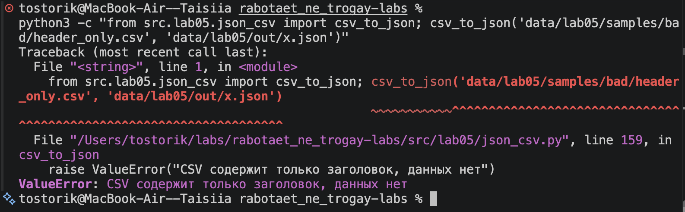
Рис.15 Ошибка: в CSV есть только заголовок

CSV не найден (`FileNotFoundError`):

```bash
python3 -c "from src.lab05.json_csv import csv_to_json; csv_to_json('data/lab05/samples/nope.csv', 'data/lab05/out/x.json')"
```

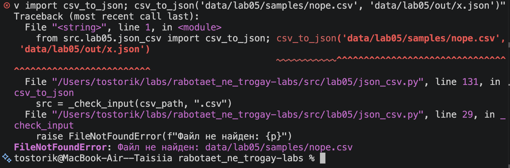
Рис.16 Ошибка: входной CSV-файл не существует

---

## Задание B — CSV -> XLSX

### Задание

Модуль `src/lab05/csv_xlsx.py` с функцией `csv_to_xlsx(csv_path, xlsx_path)` на `openpyxl`.

**Допущения:**

- Первая строка CSV — заголовок, в Excel выделяется жирным.
- Лист называется `Sheet1`.
- Ширина колонки = длина самого длинного значения + 2, но не менее 8 символов.
- Кодировка входного CSV — UTF-8, разделитель определяется автоматически.

### Запуск

Конвертация CSV -> XLSX для двух примеров:

```bash
python3 -c "from src.lab05.csv_xlsx import csv_to_xlsx; csv_to_xlsx('data/lab05/samples/people.csv', 'data/lab05/out/people.xlsx'); csv_to_xlsx('data/lab05/samples/cities.csv', 'data/lab05/out/cities.xlsx')"
```

Проверка структуры созданного файла (имя листа, число строк, ширина колонок):

```bash
python3 -c "from openpyxl import load_workbook; ws = load_workbook('data/lab05/out/people.xlsx').active; print('Лист:', ws.title); print('Строк с данными:', ws.max_row - 1); print('Колонок:', ws.max_column); [print('Ширина', k, '=', v.width) for k, v in ws.column_dimensions.items()]"
```

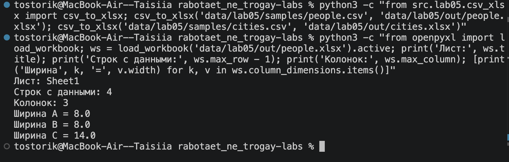
Рис.17 Проверка структуры people.xlsx

Открытие результата в программе просмотра:

```bash
open data/lab05/out/people.xlsx
```

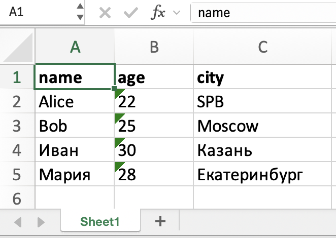
Рис.18 Файл people.xlsx в Excel

### ДО -> ПОСЛЕ

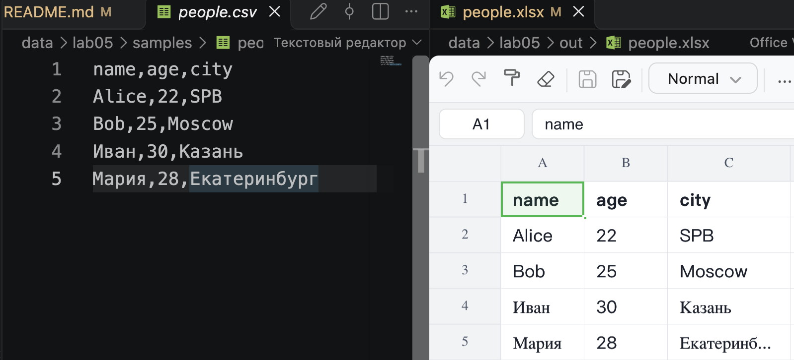  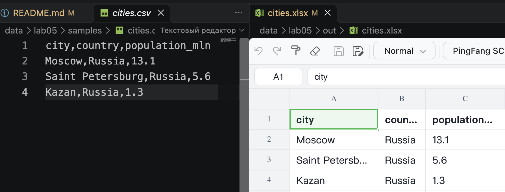
Рис.19 и Рис.20 Результат работы программы по преобразованию файла из CSV в XLSX (people.csv и cities.xlsx)

### Проверка ошибок

Файл не найден (`FileNotFoundError`):

```bash
python3 -c "from src.lab05.csv_xlsx import csv_to_xlsx; csv_to_xlsx('data/lab05/samples/nope.csv', 'data/lab05/out/x.xlsx')"
```

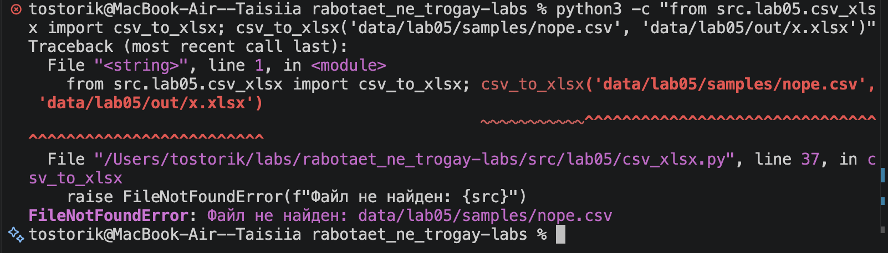
Рис.21 Ошибка: входной CSV-файл не существует

Неверный тип входного файла (`ValueError`):

```bash
python3 -c "from src.lab05.csv_xlsx import csv_to_xlsx; csv_to_xlsx('data/lab05/samples/people.json', 'data/lab05/out/x.xlsx')"
```

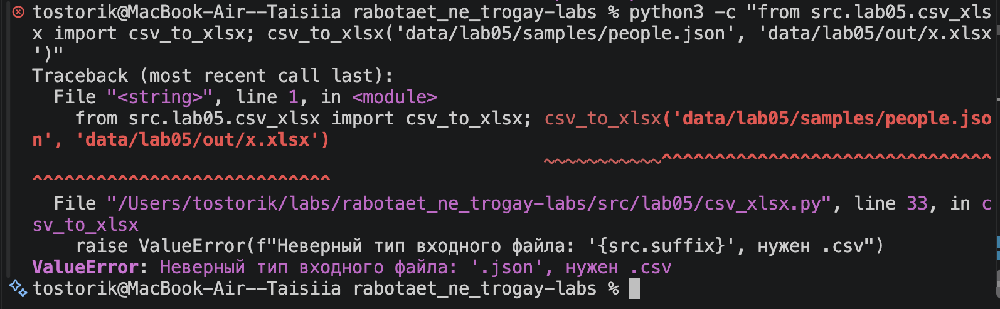
Рис.22 Ошибка: вместо .csv передан .json

Неверный тип выходного файла (`ValueError`):

```bash
python3 -c "from src.lab05.csv_xlsx import csv_to_xlsx; csv_to_xlsx('data/lab05/samples/people.csv', 'data/lab05/out/x.xls')"
```

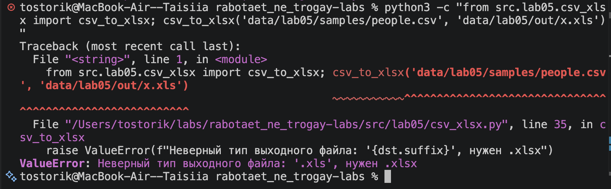
Рис.23 Ошибка: результат нужно сохранять в .xlsx, а не в .xls

Пустой CSV (`ValueError`):

```bash
python3 -c "from src.lab05.csv_xlsx import csv_to_xlsx; csv_to_xlsx('data/lab05/samples/bad/empty.csv', 'data/lab05/out/x.xlsx')"
```

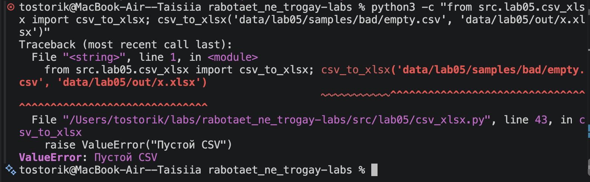
Рис.24 Ошибка: CSV пустой
