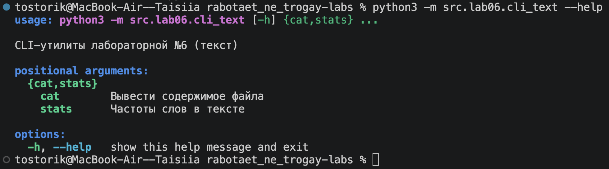
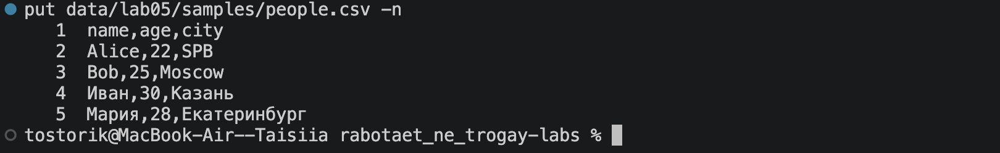
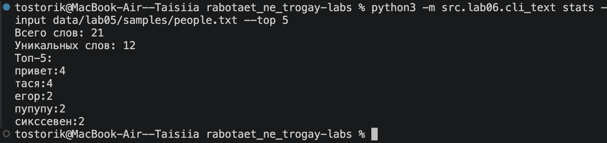
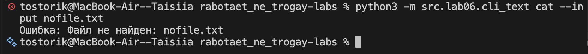
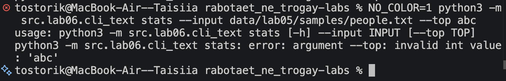
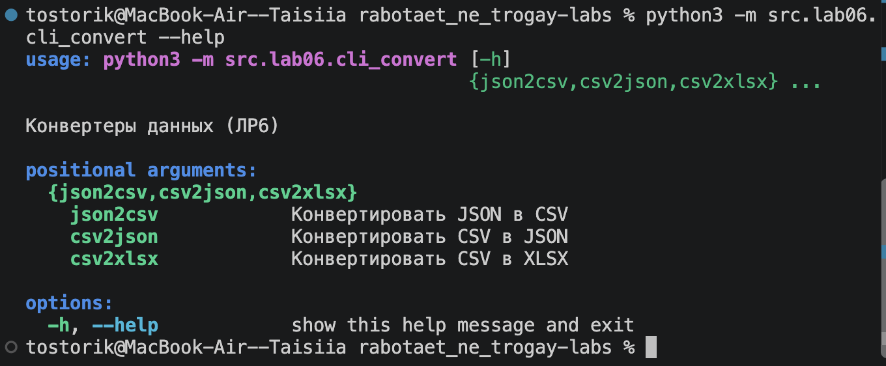
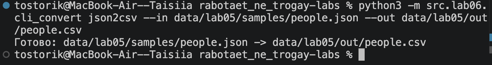
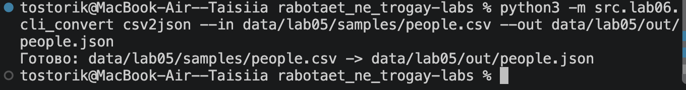
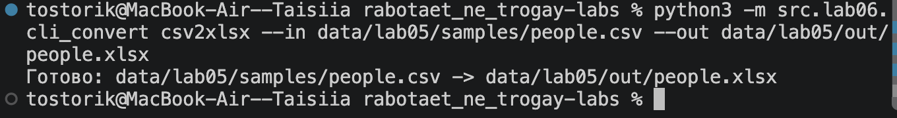
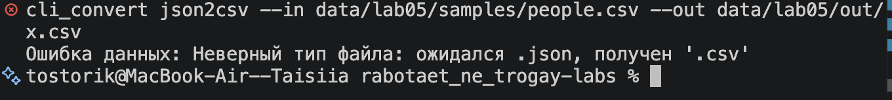

# Лабораторная работа 6

**Цель:** научиться создавать консольные утилиты с аргументами командной строки, подкомандами и флагами на модуле `argparse`.
Все команды запускаются **из корня репозитория**.

## Структура

- `src/lab06/cli_text.py` — подкоманды `cat`, `stats`
- `src/lab06/cli_convert.py` — подкоманды `json2csv`, `csv2json`, `csv2xlsx`

---

## Задание A — cli_text.py

| Подкоманда | Параметры | Описание |
|---|---|---|
| `cat` | `--input <path>`, `-n` | Вывод файла построчно, `-n` — с нумерацией |
| `stats` | `--input <txt>`, `--top N` (по умолчанию 5) | Всего слов, уникальных слов, топ-N частых слов |

Справка:

```bash
python3 -m src.lab06.cli_text --help
```


Рис.1 Справка cli_text.py

Вывод файла с нумерацией строк:

```bash
python3 -m src.lab06.cli_text cat --input data/lab05/samples/people.csv -n
```


Рис.2 Подкоманда cat с флагом -n

Частоты слов:

```bash
python3 -m src.lab06.cli_text stats --input data/lab05/samples/people.txt --top 5
```


Рис.3 Подкоманда stats

### Проверка ошибок

Файл не найден:

```bash
python3 -m src.lab06.cli_text cat --input nofile.txt
```


Рис.4 Ошибка: входной файл не существует

Неверный аргумент:

```bash
python3 -m src.lab06.cli_text stats --input data/lab05/samples/people.txt --top abc
```


Рис.5 Ошибка: --top должен быть числом

---

## Задание B — cli_convert.py

| Подкоманда | Параметры | Описание |
|---|---|---|
| `json2csv` | `--in`, `--out` | JSON -> CSV |
| `csv2json` | `--in`, `--out` | CSV -> JSON |
| `csv2xlsx` | `--in`, `--out` | CSV -> XLSX |

Справка:

```bash
python3 -m src.lab06.cli_convert --help
```


Рис.6 Справка cli_convert.py

JSON -> CSV:

```bash
python3 -m src.lab06.cli_convert json2csv --in data/lab05/samples/people.json --out data/lab05/out/people.csv
```


Рис.7 Подкоманда json2csv

CSV -> JSON:

```bash
python3 -m src.lab06.cli_convert csv2json --in data/lab05/samples/people.csv --out data/lab05/out/people.json
```


Рис.8 Подкоманда csv2json

CSV -> XLSX:

```bash
python3 -m src.lab06.cli_convert csv2xlsx --in data/lab05/samples/people.csv --out data/lab05/out/people.xlsx
```


Рис.9 Подкоманда csv2xlsx

### Проверка ошибок

Неверный тип файла:

```bash
python3 -m src.lab06.cli_convert json2csv --in data/lab05/samples/people.csv --out data/lab05/out/x.csv
```


Рис.10 Ошибка: вместо .json передан .csv