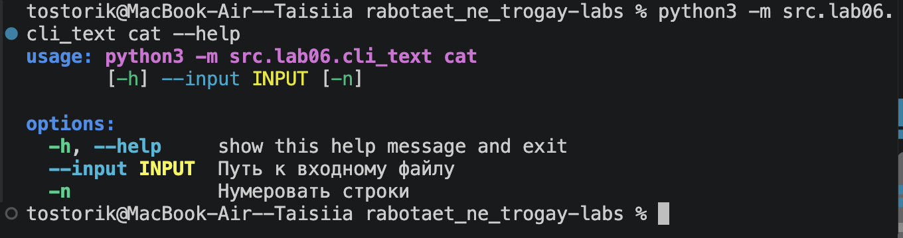
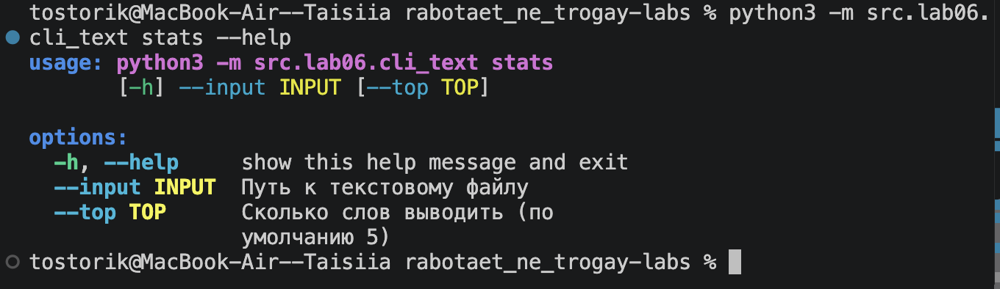
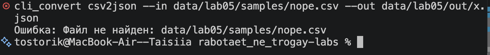
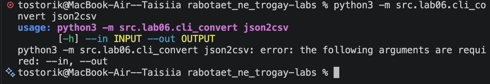
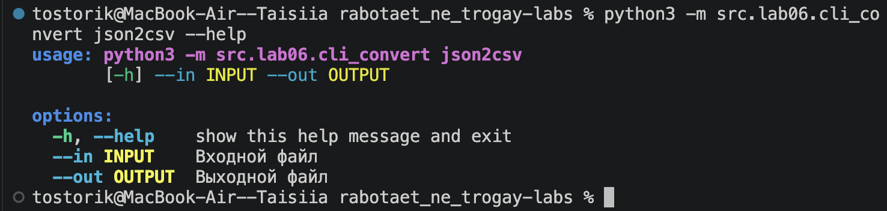
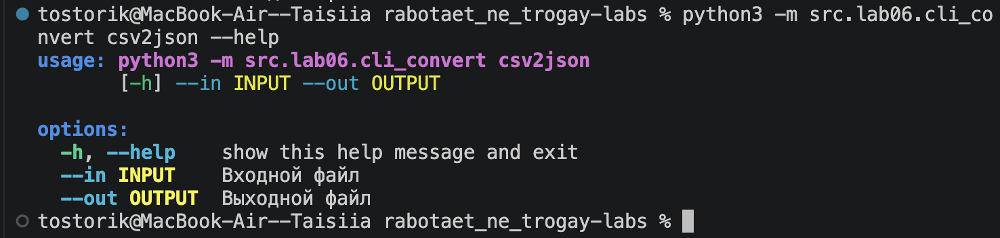
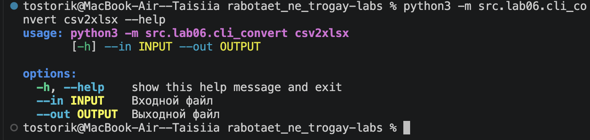
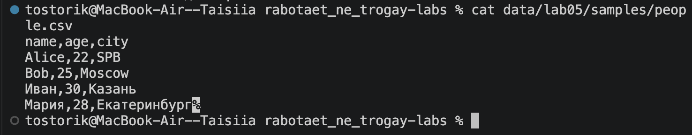
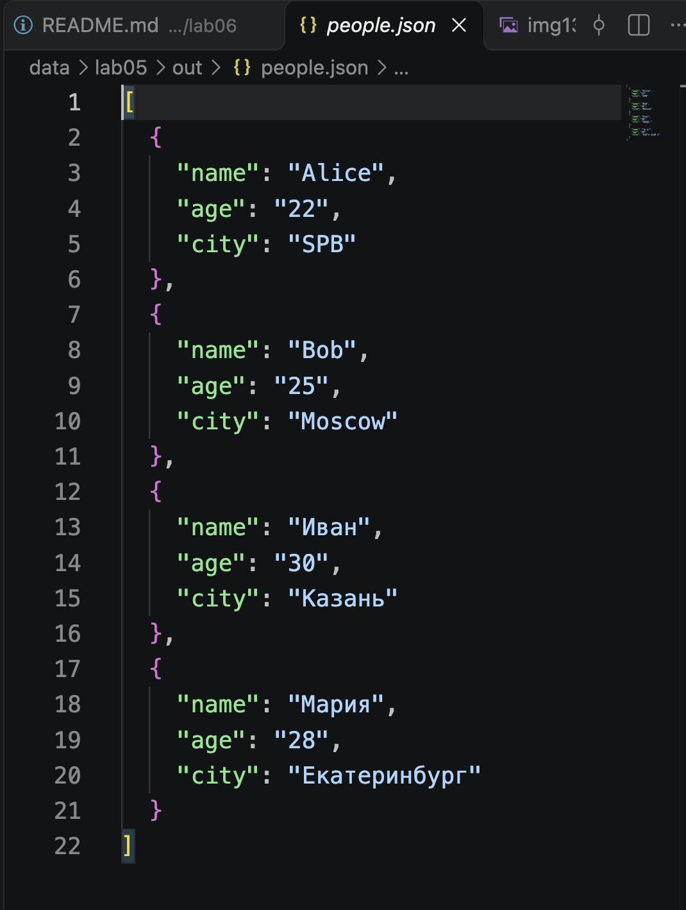
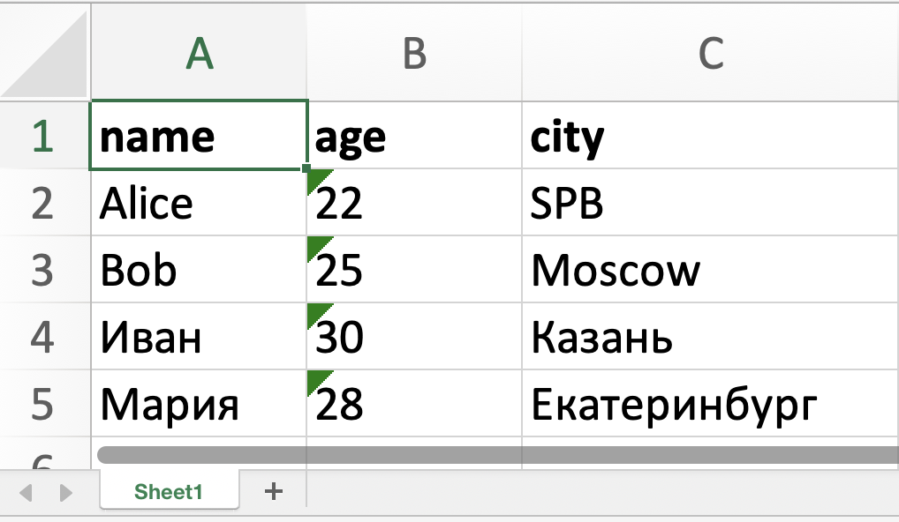

# Лабораторная работа 6

**Цель:** научиться создавать консольные утилиты с аргументами командной строки, подкомандами и флагами на модуле `argparse`.
Все команды запускаются **из корня репозитория**.

## Подготовка

Установка внешней зависимости (`openpyxl`, нужна только для `csv2xlsx`):

```bash
python3 -m pip install -r requirements.txt
```

## Структура

- `src/lab06/cli_text.py` — подкоманды `cat`, `stats`
- `src/lab06/cli_convert.py` — подкоманды `json2csv`, `csv2json`, `csv2xlsx`

---

## Задание A — cli_text.py

Модуль `cli_text.py` содержит две подкоманды для работы с текстовыми файлами.

**cat** принимает путь к файлу через `--input`, проверяет, что файл существует, читает его в кодировке UTF-8 и выводит построчно. Если указан флаг `-n`, перед каждой строкой печатается её номер (нумерация с 1).

**stats** принимает путь к текстовому файлу через `--input` и необязательный параметр `--top` (по умолчанию 5). Текст нормализуется, разбивается на слова, затем с помощью функций из ЛР3 считаются частоты. Программа выводит общее число слов, число уникальных слов и топ-N самых частых слов в формате `слово:частота`. Значение `--top` должно быть положительным числом.

| Подкоманда | Параметры | Описание |
|---|---|---|
| `cat` | `--input <path>`, `-n` | Вывод файла построчно, `-n` — с нумерацией |
| `stats` | `--input <txt>`, `--top N` (по умолчанию 5) | Всего слов, уникальных слов, топ-N частых слов |

Справка:

```bash
python3 -m src.lab06.cli_text --help
```


Рис.1 Справка cli_text.py

Вывод файла с нумерацией строк:

```bash
python3 -m src.lab06.cli_text cat --input data/lab05/samples/people.csv -n
```


Рис.2 Подкоманда cat с флагом -n

Частоты слов:

```bash
python3 -m src.lab06.cli_text stats --input data/lab05/samples/people.txt --top 5
```


Рис.3 Подкоманда stats

### Проверка ошибок

Файл не найден:

```bash
python3 -m src.lab06.cli_text cat --input nofile.txt
```


Рис.4 Ошибка: входной файл не существует

Неверный аргумент:

```bash
python3 -m src.lab06.cli_text stats --input data/lab05/samples/people.txt --top abc
```


Рис.5 Ошибка: --top должен быть числом

### Справка по подкомандам

```bash
python3 -m src.lab06.cli_text cat --help
```


Рис.6 Справка подкоманды cat

```bash
python3 -m src.lab06.cli_text stats --help
```


Рис.7 Справка подкоманды stats

---

## Задание B — cli_convert.py

Модуль `cli_convert.py` оборачивает в командную строку функции конвертации из ЛР5. Каждая подкоманда принимает два обязательных аргумента: `--in` (исходный файл) и `--out` (файл результата). После разбора аргументов программа находит выбранную подкоманду и вызывает соответствующую функцию из ЛР5.

- **json2csv** преобразует JSON-файл (список словарей) в CSV.
- **csv2json** преобразует CSV-файл с заголовком в JSON (список словарей).
- **csv2xlsx** преобразует CSV-файл в таблицу Excel (заголовок выделяется жирным, ширина колонок подбирается по содержимому).

При ошибках (файл не найден, неверное расширение, пустой или некорректный файл) выводится понятное сообщение, и программа завершается с кодом 1.

| Подкоманда | Параметры | Описание |
|---|---|---|
| `json2csv` | `--in`, `--out` | JSON -> CSV |
| `csv2json` | `--in`, `--out` | CSV -> JSON |
| `csv2xlsx` | `--in`, `--out` | CSV -> XLSX |

Справка:

```bash
python3 -m src.lab06.cli_convert --help
```


Рис.8 Справка cli_convert.py

JSON -> CSV:

```bash
python3 -m src.lab06.cli_convert json2csv --in data/lab05/samples/people.json --out data/lab05/out/people.csv
```


Рис.9 Подкоманда json2csv

CSV -> JSON:

```bash
python3 -m src.lab06.cli_convert csv2json --in data/lab05/samples/people.csv --out data/lab05/out/people.json
```


Рис.10 Подкоманда csv2json

CSV -> XLSX:

```bash
python3 -m src.lab06.cli_convert csv2xlsx --in data/lab05/samples/people.csv --out data/lab05/out/people.xlsx
```


Рис.11 Подкоманда csv2xlsx

### Проверка ошибок

Неверный тип файла:

```bash
python3 -m src.lab06.cli_convert json2csv --in data/lab05/samples/people.csv --out data/lab05/out/x.csv
```


Рис.12 Ошибка: вместо .json передан .csv

Файл не найден:

```bash
python3 -m src.lab06.cli_convert csv2json --in data/lab05/samples/nope.csv --out data/lab05/out/x.json
```


Рис.13 Ошибка: входной файл не существует

Не указаны обязательные аргументы:

```bash
python3 -m src.lab06.cli_convert json2csv
```


Рис.14 Ошибка: не указаны обязательные аргументы --in и --out

### Справка по подкомандам

```bash
python3 -m src.lab06.cli_convert json2csv --help
```


Рис.15 Справка подкоманды json2csv

```bash
python3 -m src.lab06.cli_convert csv2json --help
```


Рис.16 Справка подкоманды csv2json

```bash
python3 -m src.lab06.cli_convert csv2xlsx --help
```


Рис.17 Справка подкоманды csv2xlsx

### ДО -> ПОСЛЕ

 
Рис.18 и Рис.19 Результат работы csv2json (исходный CSV и полученный JSON)


Рис.20 Файл people.xlsx, полученный через csv2xlsx