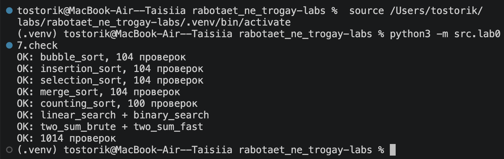
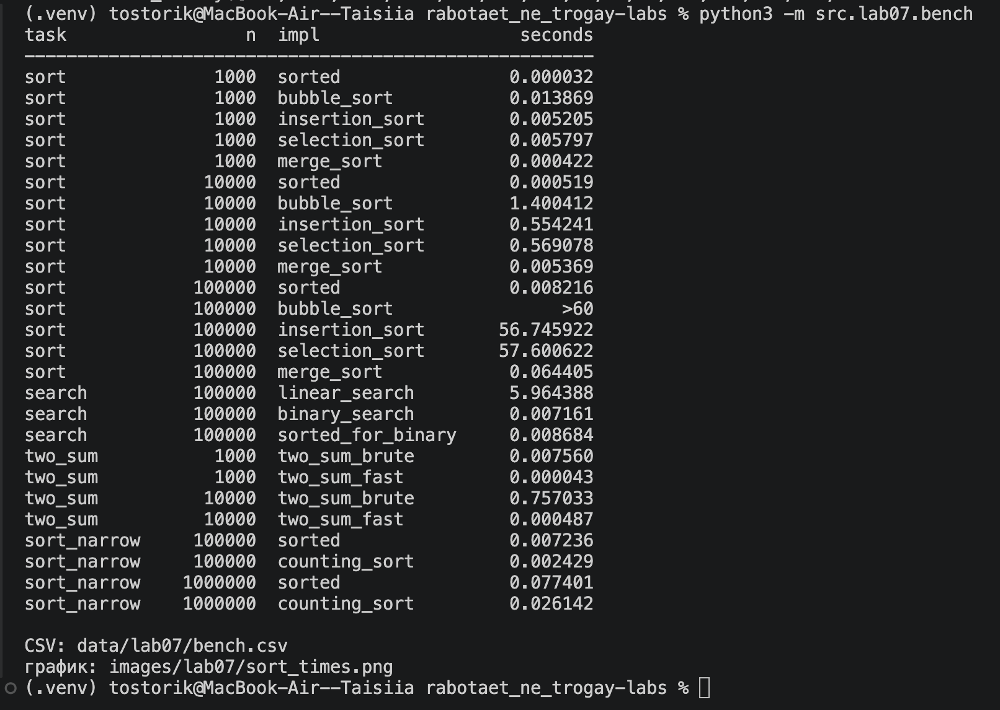
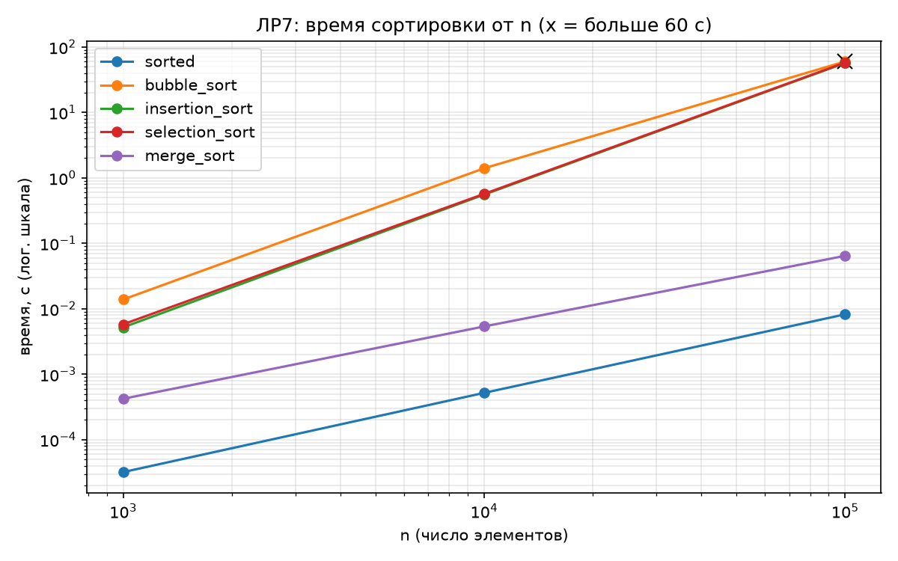
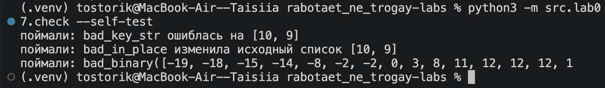

# Лабораторная работа 7. Поиск, сортировка и измерение времени

**Цель:** реализовать базовые алгоритмы поиска и сортировки, измерить их время на разных объёмах данных и проверить свои функции сравнением с эталоном.

Запуск из корня репозитория:

```
python3 -m src.lab07.check
python3 -m src.lab07.bench
```

## Что реализовано

**Поиск (`search.py`)**

- `linear_search(nums, x)` — идёт по списку и возвращает индекс первого вхождения или `-1`. `O(n)`.
- `binary_search(sorted_nums, x)` — работает только на отсортированном списке. Границы держатся инвариантом «если `x` есть, он лежит между `lo` и `hi` включительно»: цикл `while lo <= hi`, после проверки `mid` сдвиг на `mid + 1` или `mid - 1`. `O(log n)`.
- `two_sum_brute(nums, target)` — перебор пар, два вложенных цикла. `O(n²)`.
- `two_sum_fast(nums, target)` — один проход со словарём «значение → индекс»: для каждого `x` смотрим, встречалось ли `target - x`. `O(n)`.

Если ничего не нашли: поиск по индексу возвращает `-1`, Two Sum возвращает `None`.

**Сортировки (`sorting.py`)**: `bubble_sort`, `insertion_sort`, `selection_sort`. Каждая работает с копией (`list(nums)`) и возвращает новый список, исходный не меняется. Внутри нет `sorted`, `.sort()`, `min`, `max`.

- Пузырёк: за проход максимум «всплывает» в конец; добавлен флаг «обменов не было» для раннего выхода (★).
- Выбором: ищем минимум оставшейся части и ставим его на границу.
- Вставками: сдвигаем очередной элемент влево, пока не встанет на место.

**★ Дополнительно:** `merge_sort` (слияние снизу вверх, без рекурсии), `counting_sort(nums, lo, hi)` и график времени сортировок.

**Проверка (`check.py`)**: сравнивает свои функции с `sorted` и `list.index` на случайных списках (длина 0–50, значения от −100 до 100, с повторами) и на крайних случаях (пустой список, один элемент, повторы). Также проверяет, что исходный список не изменился. При расхождении падает с `AssertionError`, в сообщении лежат данные, на которых ошибка.

**Бенчмарк (`bench.py`)**: все алгоритмы получают одни и те же данные, замер через `timeit`. На каждый замер лимит 60 секунд: если не уложился, в таблице стоит «>60». Результат выводится в консоль и сохраняется в `data/lab07/bench.csv`.

## Асимптотика

**Асимптотика** показывает, как растёт число шагов алгоритма при росте размера данных `n`, не запуская программу. Запись `O(g(n))` — верхняя оценка роста (чаще всего для худшего случая), `Ω` — нижняя, `Θ` — точная.

**Правила:**

1. Константы отбрасываются: `O(n²/2) = O(n²)`.
2. Младшие слагаемые отбрасываются: `n² + 100n → O(n²)`.
3. Последовательные блоки складываются, остаётся наибольший: `O(n) + O(n²) = O(n²)`.
4. Вложенные циклы перемножаются: цикл в цикле даёт `O(n²)`.
5. Деление данных пополам даёт `log n`; основание логарифма не важно.
6. Для разных входов — разные переменные: `O(n + m)`, `O(n · m)`.
7. Вызов функции стоит как её тело: `x in list` — `O(n)`, `x in set` — `O(1)`, `sorted` — `O(n log n)`.
8. Лучший, средний и худший случаи могут отличаться (пузырёк с флагом: `O(n)` на отсортированном списке, `O(n²)` на случайном).
9. Порядок роста: `O(1) < O(log n) < O(n) < O(n log n) < O(n²) < O(2ⁿ)`.

Как проверить на опыте: при росте `n` в 10 раз время `O(n)` растёт в ~10 раз, `O(n log n)` — в ~12–13, `O(n²)` — в ~100.

| Алгоритм                           | Шагов | n = 10³ | n = 10⁴  | n = 10⁵  |
| ------------------------------------------ | ---------- | -------- | --------- | --------- |
| линейный поиск                | O(n)       | 10³     | 10⁴      | 10⁵      |
| бинарный поиск                | O(log n)   | 10       | 14        | 17        |
| пузырёк, вставки, выбор | O(n²)     | 10⁶     | 10⁸      | 10¹⁰    |
| sorted (Timsort)                           | O(n log n) | 10⁴     | 1,3·10⁵ | 1,7·10⁶ |

## Результаты

### Проверка против эталона

```
$ python3 -m src.lab07.check
OK: bubble_sort, 104 проверок
OK: insertion_sort, 104 проверок
OK: selection_sort, 104 проверок
OK: merge_sort, 104 проверок
OK: counting_sort, 100 проверок
OK: linear_search + binary_search
OK: two_sum_brute + two_sum_fast
OK: 1014 проверок
```



*Рис.1 — результат `check.py`.*

### Бенчмарк

Данные взяты из `data/lab07/bench.csv`, время в секундах.

**Сортировки**

| Алгоритм | n = 1 000 | n = 10 000 | n = 100 000 |
| ---------------- | --------: | ---------: | ----------: |
| sorted           |  0.000074 |   0.000998 |    0.014654 |
| bubble_sort      |  0.026025 |   2.640890 |         >60 |
| insertion_sort   |  0.009129 |   1.150081 |         >60 |
| selection_sort   |  0.009989 |   1.069224 |         >60 |
| merge_sort ★    |  0.000616 |   0.007992 |    0.106837 |

**Поиск** (список из 100 000 элементов, 10 000 запросов)

| Алгоритм                                                         | Время, с |
| ------------------------------------------------------------------------ | -------------: |
| linear_search                                                            |      10.578808 |
| binary_search                                                            |       0.015747 |
| сортировка списка для бинарного поиска |       0.014798 |

**Two Sum** (единственный ответ стоит в конце списка)

| Алгоритм | n = 1 000 | n = 10 000 |
| ---------------- | --------: | ---------: |
| two_sum_brute    |  0.016675 |   1.711180 |
| two_sum_fast     |  0.000088 |   0.000975 |

**★ counting_sort** (значения от 0 до 1000): при `n = 10⁵` — 0.004833 с против 0.011942 с у `sorted`; при `n = 10⁶` — 0.059648 с против 0.144293 с.



*Рис.2 — таблица бенчмарка в консоли.*



*Рис.3 — график времени сортировок от `n` (ось Y логарифмическая, крестик — «>60 с»).*

## Выводы

**Почему пузырёк при росте `n` в 10 раз замедляется в ~100 раз, а `sorted` — в ~12.** Пузырёк состоит из двух вложенных циклов и делает около `n²/2` сравнений. При `n = 1000` это ~5·10⁵ сравнений, при `n = 10 000` — ~5·10⁷, то есть в 100 раз больше. Время выросло так же: ×101 (у выбора ×107, у вставок ×126). На `n = 100 000` все три квадратичные сортировки не уложились в 60 секунд. У `sorted` сложность `O(n log n)`: при росте `n` в 10 раз число шагов растёт в `10 · log(10n) / log(n)` ≈ 12–13 раз. Измерено ×13,5 и ×14,7, так же ведёт себя `merge_sort` (×13).

**Почему бинарный поиск бесполезен без сортировки и когда она окупается.** Бинарный поиск на каждом шаге отбрасывает половину списка, считая, что слева значения меньше, а справа больше. В неотсортированном списке это не так, поэтому он может вернуть `-1` для элемента, который в списке есть, и никакой ошибки при этом не будет. Проверять порядок внутри функции нельзя: это стоило бы `n` шагов. Сортировка стоит `O(n log n)` и делается один раз: у меня `sorted` на 100 000 элементов — 14,8 мс, один линейный запрос — около 1,06 мс, один бинарный — около 1,6 мкс. Значит, сортировка окупается примерно после 14 запросов. На 10 000 запросов «сортировка + бинарный поиск» (около 31 мс) быстрее линейного поиска (10,6 с) примерно в 340 раз. Если запросов один–два, проще пройти список целиком.

## Что показал `check.py`

- **Сколько прогонов:** 1014 (`random.seed(42)`): по 104 на каждую сортировку (4 крайних случая и 100 случайных списков), 100 для `counting_sort`, остальное — поиски и Two Sum.
- **Нашёл ли расхождения:** нет, все проверки прошли, исправлять ничего не пришлось.
- **Самопроверка** (`python3 -m src.lab07.check --self-test`): я подсунула заведомо плохие функции — сортировку, которая сравнивает числа как строки (`[10, 9]` остаётся `[10, 9]`), сортировку, меняющую исходный список, и бинарный поиск с ошибкой в границах (`lo < hi` вместо `lo <= hi`). Все три были пойманы с `AssertionError`.



*Рис.4 — результат `--self-test`.*
