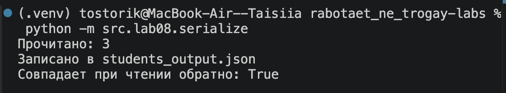
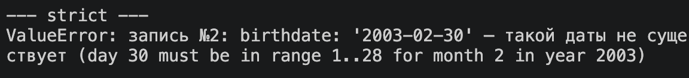
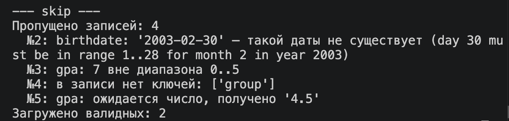
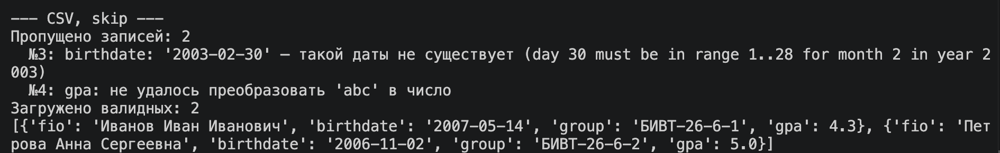

# ЛР8 — Модель данных без классов: запись Student как словарь

## Цель

Описать модель данных без классов: запись как словарь с фиксированным набором ключей, функции-конструкторы и валидация, сериализация и десериализация записей в JSON.

`Сериализация` означает превратить объект из памяти программы в текст (или байты), который можно сохранить в файл или передать. `Десериализация` означает обратное: прочитать текст и восстановить объект.

## Структура

- `src/lab08/models.py` — модель Student и функции над записью
- `src/lab08/serialize.py` — сохранение и чтение списка записей в JSON
- `data/lab08/students_input.json` — пример входных данных
- `data/lab08/students_output.json` — результат сериализации
- `data/lab08/students_bad.json` — файл с битыми записями для демонстрации валидации

## Структура записи Student

Запись — словарь с ровно четырьмя ключами, перечень которых хранится в константе `STUDENT_FIELDS = ("fio", "birthdate", "group", "gpa")`.

| Ключ      | Тип | Требования                                                                                         |
| ------------- | ------ | ------------------------------------------------------------------------------------------------------------ |
| `fio`       | str    | непустая строка (после `strip()`)                                                       |
| `birthdate` | str    | формат `YYYY-MM-DD`, дата существует и не в будущем                         |
| `group`     | str    | непустая строка                                                                                |
| `gpa`       | float  | число (не `bool`), `0 <= gpa <= 5`; `int` допустим и приводится к `float` |

```python
{"fio": "Иванов Иван Иванович", "birthdate": "2007-05-14", "group": "БИВТ-26-6-1", "gpa": 4.3}
```

## Описание функций (models.py)

- `validate_student(rec)` — проверяет готовый словарь: это `dict`, набор ключей ровно `STUDENT_FIELDS` (сообщает, каких нет и какие лишние), затем значения каждого поля. При ошибке — `ValueError` с указанием поля и причины.
- `make_student(fio, birthdate, group, gpa)` — функция-конструктор: собирает словарь, вызывает `validate_student` (вся логика проверок в одном месте) и приводит `gpa` к `float`.
- `student_age(rec, today=None)` — число полных лет на дату `today` (по умолчанию `date.today()`). Из разности годов вычитается 1, если день рождения в этом году ещё не наступил.
- `format_student(rec)` — строка вида `Иванов И.И. (БИВТ-26-6-1), 19 лет, GPA 4.30` (инициалы из ФИО, правильное склонение «год/года/лет»).
- `student_to_dict(rec)` — проверяет запись и возвращает её **копию** (новый словарь), а не тот же объект.
- `student_from_dict(d)` — десериализация: проверяет наличие нужных ключей, берёт из словаря ровно их и передаёт в `make_student` (там же происходит валидация и приведение `gpa` к `float`).

Дата проверяется через `date.fromisoformat`, а не регулярным выражением: `2003-02-30` проходит по формату, но такой даты не существует. Дополнительно формат проверяется явно, так как в Python 3.11+ `fromisoformat` принимает и другие записи (например, `20070514`). `bool` из `gpa` исключён отдельно, потому что `bool` — подкласс `int`.

## Описание функций (serialize.py)

- `students_to_json(students, path)` — каждую запись пропускает через `student_to_dict` (то есть валидирует) и сохраняет массив объектов в JSON: `ensure_ascii=False`, `indent=2`, кодировка UTF-8.
- `students_from_json(path, strict=True)` — читает JSON-массив и каждую запись пропускает через `student_from_dict`.

## Политика обработки битых записей

**По умолчанию — strict:** первая же ошибка приводит к `ValueError` с номером записи и причиной. Обоснование: программа, которая молча продолжает работать с неверными данными, хуже программы, которая упала.

Режим **skip** доступен через параметр `strict=False`: битые записи пропускаются, в конце в консоль выводится, сколько записей пропущено и почему.

## Примеры запуска

Запуск из корня репозитория:

```
python -m src.lab08.serialize
```

Результат:

```
Прочитано: 3
Записано в students_output.json
Совпадает при чтении обратно: True

--- strict ---
ValueError: запись №2: birthdate: '2003-02-30' — такой даты не существует (day 30 must be in range 1..28 for month 2 in year 2003)

--- skip ---
Пропущено записей: 4
  №2: birthdate: '2003-02-30' — такой даты не существует (day 30 must be in range 1..28 for month 2 in year 2003)
  №3: gpa: 7 вне диапазона 0..5
  №4: в записи нет ключей: ['group']
  №5: gpa: ожидается число, получено '4.5'
Загружено валидных: 2
```

Примеры работы функций модели:

```python
s = make_student("Иванов Иван Иванович", "2007-09-20", "БИВТ-26-6-1", 4.3)
student_age(s, date(2026, 9, 19))   # 18
student_age(s, date(2026, 9, 20))   # 19
format_student(s)                   # Иванов И.И. (БИВТ-26-6-1), 19 лет, GPA 4.30
```

## Примеры JSON

**До (students_input.json)** — фрагмент:

```json
{"fio": "Петрова Анна Сергеевна", "birthdate": "2006-11-02", "group": "БИВТ-26-6-2", "gpa": 5}
```

**После (students_output.json)** — фрагмент (`gpa` приведён к `float`):

```json
{"fio": "Петрова Анна Сергеевна", "birthdate": "2006-11-02", "group": "БИВТ-26-6-2", "gpa": 5.0}
```

**Битые записи (students_bad.json):**

| № | Проблема                                     |
| -- | ---------------------------------------------------- |
| 2  | несуществующая дата `2003-02-30` |
| 3  | `gpa = 7` вне диапазона                |
| 4  | отсутствует ключ `group`            |
| 5  | `gpa` передан строкой `"4.5"`      |

## Скриншоты






## Дополнительное задание ★
- `update_student(rec, **fields)` — возвращает новую запись с изменёнными полями, исходная не меняется (изменения вносятся в копию). Неизвестный ключ → `KeyError`; неверное значение → `ValueError` (проверка через `validate_student`).
- `students_from_csv(path, strict=True)` — чтение через `csv.DictReader` (заголовок `fio,birthdate,group,gpa`), та же политика strict/skip.

**Где изменяется `gpa` из CSV:** CSV хранит все значения как текст, поэтому `gpa` приходит строкой. Преобразование `float(...)` выполняется в `students_from_csv` до вызова `student_from_dict`; сама модель остаётся строгой и строку вместо числа не принимает.


